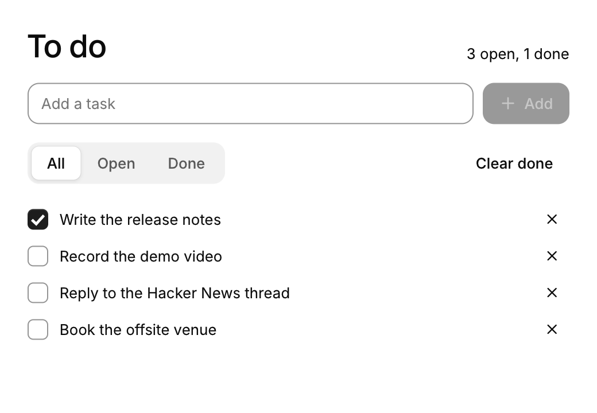

# Tutorial: build a to-do app

[Getting started](getting-started.md) opened a window. This tutorial builds a small, complete app in it: a to-do list you can add to, tick off, filter and clear, which saves itself to a file. It takes about a quarter of an hour, and the result is about 130 lines of C.

<picture><source media="(prefers-color-scheme: dark)" srcset="images/tutorial-todo-dark.png"></picture>

Along the way it covers what most apps need: your own data as the state, a list that grows, ids for repeated rows, a dialog, and saving. The finished program is [`examples/todo.c`](../examples/todo.c). CUI's tests build it, type into it and check that it does what this page says, and it runs in your browser among the [apps on the site](https://yappologistic.github.io/CUI/#/app/todo).

## 1. A window and a frame function

Start from the project of [Getting started](getting-started.md#with-cmake-recommended): a `CMakeLists.txt` that links `cui::cui`, and a `main.c`.

```c
#include <cui/cui.h>
#include <cui/cui_app.h>
#include <stdio.h>
#include <string.h>

typedef struct {
    int nothing_yet;
} app_state;

static void frame(cui_ctx *ui, void *user) {
    app_state *a = user;
    (void)a;
    cui_column(ui, .pad = 24, .gap = 16) {
        cui_heading(ui, "To do", 2);
    }
}

int main(void) {
    static app_state a;
    return cui_app_run(&(cui_app_desc){ .title = "To do", .width = 520, .height = 640 }, frame, &a);
}
```

`cui_app_run` opens the window and calls `frame` whenever the screen needs drawing: after input, during an animation, and not at all while nothing happens. `frame` describes the whole screen each time. There are no widgets to create and keep; what stays between frames is your `app_state`.

## 2. Your data is the state

The app is a list of tasks, so that is what the state holds. Plain arrays are fine:

```c
#define MAX_TASKS 200

typedef struct { char title[96]; bool done; } task;

typedef struct {
    task tasks[MAX_TASKS];
    int count;
    char draft[96];        /* what is being typed into the field */
    int filter;            /* 0 all, 1 open, 2 done */
    bool confirm_clear;    /* the dialog is open */
    char path[512];        /* the file the list is saved in */
} app_state;
```

Everything the screen shows comes from this struct. To show a count, count:

```c
int done = 0;
for (int i = 0; i < a->count; i++) done += a->tasks[i].done;

cui_row(ui, .gap = 12, .align = CUI_ALIGN_END) {
    cui_heading(ui, "To do", 2);
    cui_spacer(ui);
    cui_textf(ui, "%d open, %d done", a->count - done, done);
}
```

There is nothing to update when a task changes. The next frame reads the array again and draws what it finds.

## 3. Add a task: a field and a button

A component is a function call that returns what happened this frame. A text field edits your buffer and says whether Enter was pressed; a button returns true on the frame it is clicked:

```c
cui_row(ui, .gap = 8) {
    int typed = cui_input(ui, "new-task", a->draft, sizeof a->draft, .placeholder = "Add a task", .width = CUI_FILL);
    bool add = cui_button(ui, "Add", .variant = CUI_BUTTON_PRIMARY, .icon = CUI_ICON_PLUS, .disabled = !a->draft[0]);
    if ((typed & CUI_SUBMITTED) || add) changed |= add_task(a);
}
```

`add_task` is ordinary C: it copies the draft into the next free task and empties the draft, which empties the field, because the field shows your buffer.

```c
static bool add_task(app_state *a) {
    if (!a->draft[0] || a->count >= MAX_TASKS) return false;
    task *t = &a->tasks[a->count++];
    snprintf(t->title, sizeof t->title, "%s", a->draft);
    t->done = false;
    a->draft[0] = 0;
    return true;
}
```

The options after the required arguments (`.placeholder`, `.variant`, `.disabled`) are named arguments. Leave any out and it takes its default.

## 4. A list that grows: give each row an id

Draw the tasks with a loop. Each one is a checkbox bound to its `done` flag, and a delete button:

```c
int remove = -1;
cui_scroll(ui, .id = "tasks", .width = CUI_FILL, .height = CUI_FILL, .gap = 2) {
    for (int i = 0; i < a->count; i++) {
        task *t = &a->tasks[i];
        cui_push_id_int(ui, i);
        cui_row(ui, .gap = 8, .align = CUI_ALIGN_CENTER, .width = CUI_FILL) {
            if (cui_checkbox(ui, t->title, &t->done)) changed = true;
            cui_spacer(ui);
            if (cui_icon_button(ui, CUI_ICON_X, .tooltip = "Delete", .variant = CUI_BUTTON_GHOST, .size = CUI_SIZE_SM)) remove = i;
        }
        cui_pop_id(ui);
    }
}
if (remove >= 0) {
    memmove(&a->tasks[remove], &a->tasks[remove + 1], sizeof(task) * (size_t)(a->count - remove - 1));
    a->count--;
    changed = true;
}
```

Two things here are worth knowing in every CUI app.

**Ids.** CUI keeps a little state per component (a hover fade, a checkbox's animation), and finds it by an id made from the label. Two tasks called "Buy milk" would share one, and so would every row's delete button. `cui_push_id_int(ui, i)` and `cui_pop_id` wrap each row in its own scope, so every row is distinct. Use an id scope around anything you draw in a loop.

**Change the array after the loop.** The delete button only notes which row was clicked. Removing the task right there would shift the tasks under the loop that is still drawing them.

`cui_scroll` gives the list its own scrolling once it is taller than the window, and `.height = CUI_FILL` hands it the space that is left.

## 5. A filter, and something to show when the list is empty

A segmented control writes the index of its selection into an `int`:

```c
static const char *filters[] = { "All", "Open", "Done" };
cui_segmented(ui, "filter", filters, 3, &a->filter);
```

Filtering is an `if` in the loop, and an empty result is a good place for an empty state:

```c
if ((a->filter == 1 && t->done) || (a->filter == 2 && !t->done)) continue;
shown++;
```

```c
if (!shown)
    cui_empty_state(ui, a->count ? "Nothing here" : "No tasks yet", .icon = CUI_ICON_LIST_CHECKS,
                    .description = a->count ? "No task matches this filter." : "Type one above and press Enter.");
```

This is how conditional interface works in immediate mode: you do not show and hide things, you call the function or you do not.

## 6. Ask first: a dialog

Clearing the finished tasks destroys data, so ask. A dialog is shown while a `bool` of yours is true, and closing it (the x, Esc, a click outside) sets the `bool` to false:

```c
if (cui_button(ui, "Clear done", .variant = CUI_BUTTON_GHOST, .disabled = done == 0)) a->confirm_clear = true;
```

```c
cui_dialog(ui, "Clear finished tasks?", &a->confirm_clear, .description = "They are removed from the list and from the file.", .width = 380) {
    cui_dialog_footer(ui) {
        if (cui_button(ui, "Cancel")) a->confirm_clear = false;
        if (cui_button(ui, "Clear", .variant = CUI_BUTTON_DANGER)) {
            int kept = 0;
            for (int i = 0; i < a->count; i++) if (!a->tasks[i].done) a->tasks[kept++] = a->tasks[i];
            a->count = kept;
            a->confirm_clear = false;
            changed = true;
            cui_toast(ui, "Finished tasks cleared");
        }
    }
}
```

Put the dialog at the end of `frame`, outside the layout: it draws over everything and keeps Tab inside itself while it is open. `cui_toast` shows a short message in the corner.

## 7. Save and load

The state is your struct, so saving is writing it. One line per task is enough:

```c
static void save(const app_state *a) {
    if (!a->path[0]) return;
    FILE *f = fopen(a->path, "w");
    if (!f) return;
    for (int i = 0; i < a->count; i++) fprintf(f, "%c %s\n", a->tasks[i].done ? 'x' : '-', a->tasks[i].title);
    fclose(f);
}
```

Every place that changed the list above set `changed`. At the end of the frame, save once:

```c
if (changed) save(a);
```

Loading happens before the window opens, in `main`:

```c
int main(void) {
    static app_state a;
    snprintf(a.path, sizeof a.path, "todo.txt");   /* beside where the app is started */
    load(&a);
    return cui_app_run(&(cui_app_desc){ .title = "To do", .width = 520, .height = 640 }, frame, &a);
}
```

`load` is the mirror of `save`; see it in [`examples/todo.c`](../examples/todo.c).

## 8. Fit any window, and build it small

Wrap the content in a column with a maximum width, centered in the window, and the app reads well from a phone-sized window to a full screen:

```c
cui_column(ui, .width = CUI_FILL, .height = CUI_FILL, .align = CUI_ALIGN_CENTER, .bg = CUI_COLOR_BACKGROUND) {
    cui_column(ui, .width = CUI_FILL, .max_width = 560, .height = CUI_FILL, .pad = 24, .gap = 16) {
        /* everything from the steps above */
    }
}
```

Build a release, with `cui_app_target(my_app)` in your `CMakeLists.txt` so that only the components you used are linked:

```sh
cmake -S . -B build -DCMAKE_BUILD_TYPE=MinSizeRel
cmake --build build
./build/my_app
```

The whole app, window, fonts and all, is about 270 KB on Linux.

## Where next

- The keyboard already works: Tab moves through the field, the filter and the rows, Space ticks a task, and Esc closes the dialog. [Getting started](getting-started.md#6-keyboard-shortcuts) shows how to add your own shortcuts.
- [Layout](layout.md) explains rows, columns, sizes and grids. [Theming](theming.md) switches to dark mode and changes the accent in one call each.
- [Components](components.md) and [More components](components-more.md) list everything else you can call, each with a live example on the [site](https://yappologistic.github.io/CUI/).
- The [example apps](../examples) are larger programs built the same way: a mail client, notes, a tracker, a music player.
